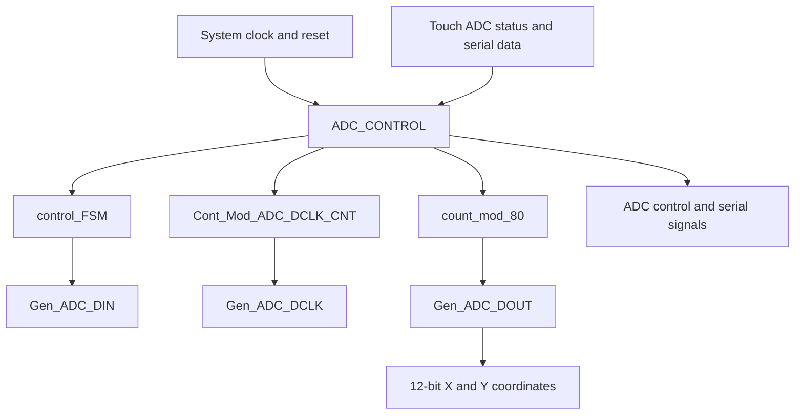

# Verilog AD7843 Touch Controller

FPGA-based touchscreen interface implemented in **Verilog HDL** for communication with an **AD7843-compatible touch-panel ADC**. The design uses a finite-state machine (FSM), configurable counters, and serial data-path modules to acquire **12-bit X and Y touch coordinates**.

The design was developed with **Intel/Altera Quartus** for the **Terasic DE2-115** FPGA development board and functionally verified using **ModelSim**.

## Features

- Serial control interface for touchscreen coordinate acquisition
- Acquisition of 12-bit X and Y coordinate samples
- FSM-based control of ADC selection and transfer sequencing
- Configurable timing derived from a 50 MHz system clock
- Dedicated serial clock, command-data, and received-data modules
- Verilog testbench and a behavioral verification framework

## Hardware and development tools

| Item | Description |
| --- | --- |
| FPGA board | Terasic DE2-115 |
| Touch ADC | AD7843-compatible serial ADC |
| HDL | Verilog |
| FPGA design tool | Intel/Altera Quartus |
| Simulation tool | ModelSim |
| System clock | 50 MHz in the original design |

## Repository structure

```text
Verilog-AD7843-Touch-Controller/
├── rtl/
│   ├── ADC_CONTROL.v
│   ├── Cont_Mod_ADC_DCLK_CNT.v
│   ├── control_FSM.v
│   ├── count_mod_80.v
│   ├── Gen_ADC_DCLK.v
│   ├── Gen_ADC_DIN.v
│   └── Gen_ADC_DOUT.v
├── tb/
│   ├── MFB.v
│   └── tb_Touch_Control.v
└── README.md
```

## RTL architecture

`ADC_CONTROL` integrates the timing, control, and serial data-path logic.



The diagram is a functional overview, not a complete signal-by-signal netlist.

### RTL modules

| Module | Responsibility |
| --- | --- |
| `ADC_CONTROL.v` | Top-level integration of the ADC serial interface and coordinate outputs |
| `Cont_Mod_ADC_DCLK_CNT.v` | Parameterized timing counter for ADC clock and transfer timing |
| `count_mod_80.v` | Counter used to track the serial acquisition sequence |
| `control_FSM.v` | Finite-state machine controlling conversion and transfer phases |
| `Gen_ADC_DCLK.v` | Generation of the ADC serial clock signal |
| `Gen_ADC_DIN.v` | Transmission of ADC command and configuration bits |
| `Gen_ADC_DOUT.v` | Capture and assembly of received X/Y coordinate bits |

The main interface uses a system clock and active-low reset, receives ADC status/serial data, and drives serial control signals together with the **12-bit coordinate outputs**.

## Verification

The repository includes:

- `tb/tb_Touch_Control.v` — Top-level simulation testbench, instantiating `ADC_CONTROL`, `MFB`, and `EMULE_ADC`.
- `tb/MFB.v` — Verification framework used to drive ADC conversion scenarios and check results.

The original verification included multiple consecutive X/Y conversion transactions without an intervening reset, using ModelSim waveform inspection and testbench checks.

### Required external simulation model

**The original testbench depends on an `EMULE_ADC` module**, instantiated in `tb_Touch_Control.v`. Its original simulation file is named `EMULE_ADC.vo` and **is not included in this repository**.

To reproduce the original complete testbench, provide a compatible `EMULE_ADC` simulation model separately and compile it alongside the files in `rtl/` and `tb/`. Check the model's redistribution terms before publishing it. Without that model, the complete testbench is not self-contained and cannot be expected to elaborate successfully.

The project-specific Quartus configuration and generated simulator/netlist files are also not included. ModelSim library setup may be necessary depending on the external model used.

## Scope and limitations

This repository contains the **source RTL and the available testbench files**, rather than a full archived Quartus project. It is intended to document and share the digital interface implementation.

The source snapshot corresponds to the **base ADC interface**, not the later extension described elsewhere with a 25-million-cycle delay counter and seven-segment coordinate display. Those additional modules are not present here and are not claimed as part of this repository.

For hardware deployment on the DE2-115, recreate the Quartus project, assign FPGA pins, configure timing constraints, and connect the appropriate ADC/touchscreen hardware.
